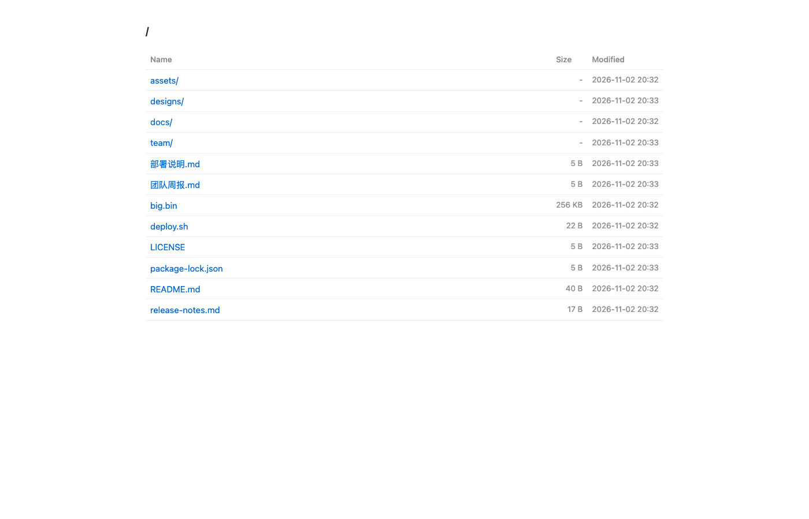
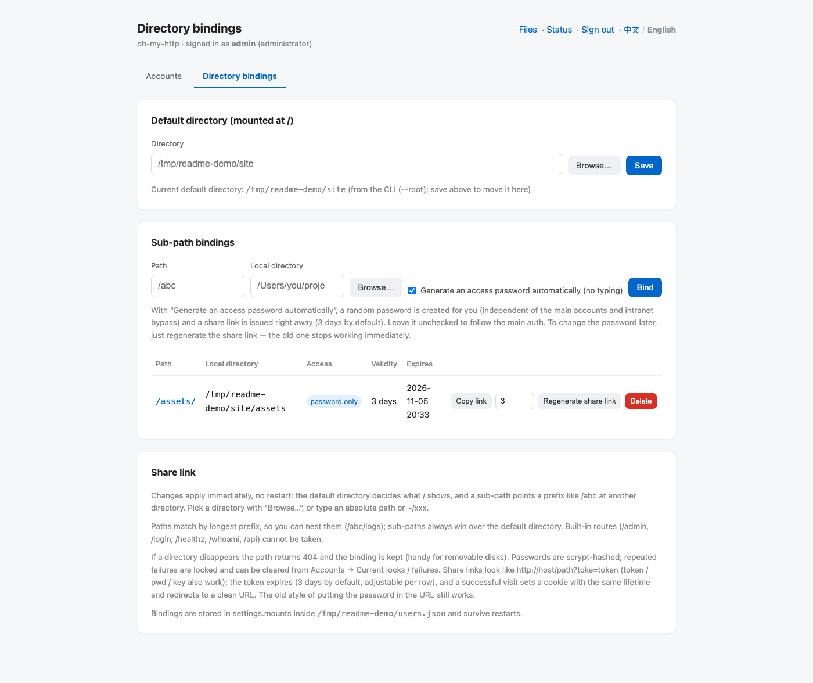
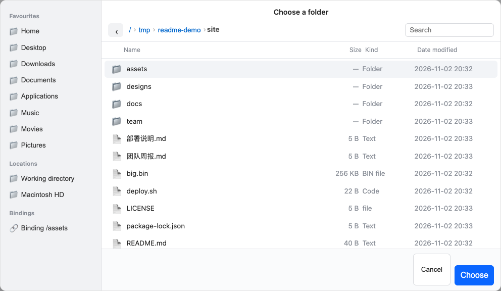
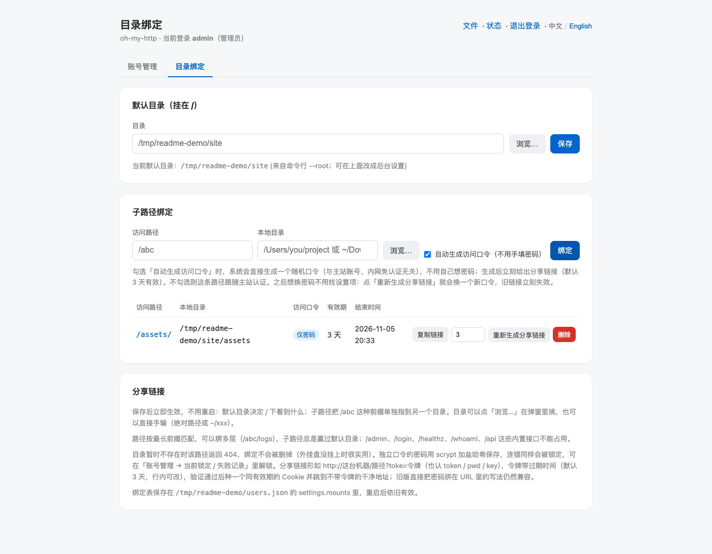

# oh-my-http

**Turn a local directory into a password-protected website with one command.** Zero dependencies, single process, runs in the background by default — no login from the intranet, password from outside.

[中文](README.md) · [Changelog](CHANGELOG.md) · [npm](https://www.npmjs.com/package/oh-my-http)

```bash
npx oh-my-http ~/Downloads                 # serve it, open http://127.0.0.1:25250/
npx oh-my-http ~/Downloads --pass s3cret   # add a password (the LAN still bypasses it)
```

## Screenshots

Directory browsing (the directory is mounted at `/`):



Directory bindings: default directory plus sub-paths, per-path passwords and share links (validity / expiry / copy):



“Browse…” opens a Finder-style folder picker (Favourites / Locations / Bindings):



The UI ships in Chinese and English — switch at the top right (Chinese version: [README.md](README.md)).



## Features

- **Zero dependencies** — only Node built-ins; `npm i -g` and you are done
- **Browse / download** — per-directory listings with size and mtime; `index.html` wins when present
- **Optional auth** — login page + cookie by default, or Basic; intranet sources skip login
- **Brute-force protection** — lockouts per account (optionally per IP), unlock from the admin UI
- **Multiple bindings** — `/` uses the default directory, a prefix like `/abc` can point elsewhere, **effective immediately, no restart**
- **Share links** — a per-path password plus a signed `?toke=…` link valid for 3 days by default
- **Chinese / English UI** — switch in the admin settings, or follow the browser language
- **Usable as a library** — `createServer()` + `listen()`

Requires Node.js **>= 18.17** (ESM, MIT).

## Install

```bash
npm i -g oh-my-http      # global install
npx oh-my-http --help    # or run it without installing
```

## Quick start

```bash
# 1. simplest: current directory at /, port 25250, no auth
oh-my-http

# 2. a directory plus a password (the first run creates the admin account)
oh-my-http ~/Downloads --pass s3cret

# 3. require auth without a preset password: the first visitor to /login creates the admin
oh-my-http ~/Downloads --require-auth

# 4. another port / bind to loopback only
oh-my-http ~/Downloads --port 9000 --host 127.0.0.1

# 5. expose no directory at all, keep only the built-in routes
oh-my-http --no-files
```

It daemonizes by default: the command returns immediately and prints the port, directory, log file and stop/restart commands.

## Managing the process

```bash
oh-my-http status                  # all instances (PID / port / directory / uptime)
oh-my-http stop                    # stop (add --port when several run)
oh-my-http restart --port 25250    # restart with the previous arguments
oh-my-http . --foreground          # run in the foreground (docker / systemd / debugging)
tail -f ~/.oh-my-http/log-25250.log
```

- Background by default; containers (PID 1) and systemd environments switch to foreground automatically.
- `restart` reuses the saved arguments; passwords are not written to disk, accounts live in the account file.
- State, logs and accounts live in `~/.oh-my-http/` (override with `--state-dir`).

## Start on login

Install it as a **user-level service** (macOS LaunchAgent / Linux systemd --user): it starts when you log in
and is restarted if it dies.

```bash
# the directory and flags are written into the service definition as-is
oh-my-http service install ~/Downloads --port 25250 --pass s3cret

oh-my-http service status        # installed? running?
oh-my-http service uninstall     # stop and remove
```

- macOS → `~/Library/LaunchAgents/cn.xs25.oh-my-http.25250.plist` (`RunAtLoad` + `KeepAlive`)
- Linux → `~/.config/systemd/user/oh-my-http-25250.service` (`Restart=always`)
- The service runs in the **foreground**; logs go to `~/.oh-my-http/service-25250.log`
- Run `oh-my-http stop --port 25250` first, otherwise a manually started instance holds the port
- User-level services start after login. To run **before login**, use a root LaunchDaemon / systemd system unit
  (on Linux `sudo loginctl enable-linger $USER` also keeps user services alive without a login)

## Auth and accounts

| Mode | Behaviour |
| --- | --- |
| `--pass <password>` | Creates the admin on first run, ignored afterwards (`--reset-pass` forces an overwrite) |
| `--require-auth` | Auth on, no preset password: the first visitor to `/login` creates the admin (remote sources need the setup token from the startup log) |
| neither | No auth at all — anyone who can reach the port can browse (the home page shows a red warning) |
| `--auth basic` | Classic Basic dialog; the default `form` uses a login page + cookie |

- Accounts live in `~/.oh-my-http/users.json` (scrypt + salt, mode 0600); roles are **admin** and **member**.
- Admins add people, reset passwords, disable or delete accounts from `/admin`; at least one usable admin is kept.
- **Local bypass**: direct requests from `127.0.0.1` without `X-Forwarded-For` enter as admin; disable with `--no-local-admin`.
- **Intranet bypass**: loopback, private, link-local, ULA and CGNAT ranges are trusted by default; add with `--trusted`, disable with `--no-default-trusted`.
- **Lockouts**: 3 failures per account → 60 minutes by default; both are editable in the admin UI, `0` disables.

## Directory bindings

The CLI binds one directory:

```bash
oh-my-http ~/Downloads                 # mounted at /
oh-my-http ~/Downloads --mount /files  # adds a /files prefix
oh-my-http --no-files                  # bind nothing
```

For several directories use the **Directory bindings** page (`/admin/bindings`):

| Setting | Effect |
| --- | --- |
| Default directory (mounted at `/`) | what `/` serves; overrides the CLI `--root` / `--mount`, clearing it falls back |
| Sub-path bindings | `/abc` → another directory; longest prefix wins, nesting works (`/abc/logs`) |

- Pick a directory in the Finder-style dialog (Favourites / Locations / Bindings) or type it (absolute path or `~/xxx`).
- Longest prefix wins; built-in routes (`/admin`, `/login`, `/healthz`, `/whoami`, `/api`, …) cannot be taken.
- A missing directory returns 404 for that path — the binding is kept.
- Bindings are stored in `settings.mounts` of the account file and survive restarts; with `--users-file none` they are memory-only.

## Share links

Do not want to hand out the main account? Give one sub-path its own password:

1. Tick “Generate an access password automatically” when adding a binding (on by default), or press “Create share link” on that row later.
2. A random password is generated and a link is issued: `http://host/gp?toke=<signed token>`, **valid for 3 days by default**.
3. Send the link. Opening it:
   - verifies the token → sets a cookie scoped to that path with the same lifetime → redirects to a clean URL;
   - sub-directories and downloads keep working; the link itself stays usable until it expires.
4. The table shows **validity** and **expires**; while it is still valid you can “Copy link” again.
5. To change the password, press “Regenerate share link” — the old link and cookie stop working at once.

Notes:

- The token is HMAC-signed and contains no password; the password itself is stored as a scrypt hash.
- `?toke=` is the canonical parameter (`token` / `pwd` / `key` also work); the old style of putting the raw password in the URL still works.
- Repeated failures are locked per path; clear them from Accounts → Current locks / failures.
- To stop protecting a path, delete the binding and re-add it without the automatic password; without a password it follows the main auth.

## New version notices

When a new version is out, the **admin pages show a banner** at the top (current → latest, the upgrade
command and a release-notes link), plus a “Check for updates” link to refresh it. Results are cached in
`~/.oh-my-http/update-check.json`:

- checked once at startup (printed by `-f`, written to the log when running as a daemon)
- if the cache is older than 24h, or an admin opens the panel and nothing has been checked yet, it
  re-checks in the background (at most once every 10 minutes)
- opt out with `--no-update-check`, `OHMY_NO_UPDATE_CHECK=1`, `NO_UPDATE_NOTIFIER=1` or `CI=true`

## UI language

The top-right corner of the admin pages switches **中文 / English**; the choice is stored in the account file and applies immediately (including the login page).
Without a saved choice the browser's `Accept-Language` is used, falling back to Chinese.

## Built-in routes

| Path | Description |
| --- | --- |
| `GET /healthz` | public health check (auth-free by default) |
| `GET /whoami` | source IP, auth method and current identity |
| `POST /api/echo` | echoes method / headers / body |
| `GET /login`, `/logout` | login page and sign-out (form mode) |
| `GET /admin` | account management (admin) |
| `GET /admin/bindings` | directory bindings and share links (admin) |
| `GET /admin/api/dirs?path=…` | data source for the directory picker (admin, read-only) |

## Security notes

- Dot-files are neither listed nor served by default (`--hidden` relaxes this).
- Static serving is guarded against path traversal: the resolved path must stay inside the bound directory.
- Session cookies are HttpOnly + SameSite=Lax; the signing secret is persisted with the accounts, so restarts keep people signed in.
- Every admin write requires a CSRF token; form login and `curl -u` share one lockout counter.
- Behind a tunnel / reverse proxy consider `--no-default-trusted`, `--no-local-admin` and `--secure-cookie`.

## CLI flags

`oh-my-http --help` lists everything; the common ones:

| Flag | Description |
| --- | --- |
| `--host` / `--port` / `--addr` | listen address, default `0.0.0.0:25250` |
| `--pass` / `--require-auth` / `--auth form\|basic` | authentication |
| `--root` / `--mount` / `--no-files` | bound directory and mount point |
| `--hidden` | allow dot-files |
| `--trusted <cidr>` / `--no-default-trusted` | trusted (login-free) networks |
| `--account-max-attempts` / `--ip-max-attempts` / `--lockout-minutes` | lockout policy |
| `--users-file` / `--state-dir` | account file and state directory |
| `--session-days` / `--remember-days` / `--secure-cookie` | session lifetime |
| `--check-ip <ip>` | explain what a given IP would get, without starting the server |
| `-f` / `--foreground`, `-q` / `--quiet`, `-v`, `-h` | foreground, quiet, version, help |

## As a library

```js
import { loadConfig, createServer, listen } from 'oh-my-http'

const cfg = loadConfig(['~/Downloads', '--pass', 's3cret'], process.env)
const server = createServer(cfg)
await listen(server, { host: '127.0.0.1', port: 8080 })
```

Smaller pieces are exported too (`serveStatic`, `explainAccess`, `normalizeBindings`, …); see `index.d.ts`.

## Development

```bash
git clone git@github.com:duzhenxun/oh-my-http.git && cd oh-my-http
npm test          # unit tests (node --test)
npm run smoke     # end-to-end: spawns the real CLI
npm run demo      # local demo
```

CI (`.github/workflows/ci.yml`) runs tests + smoke on Node 20 / 22 / 24.

## Releasing

Pushing a `v*` tag publishes automatically (GitHub Actions + npm Trusted Publishing, no token, with provenance):

```bash
npm version minor -m "v%s"   # bumps both version files and creates the tag
git push --follow-tags
```

See [RELEASING.md](RELEASING.md) for the one-time setup.

## License

MIT
