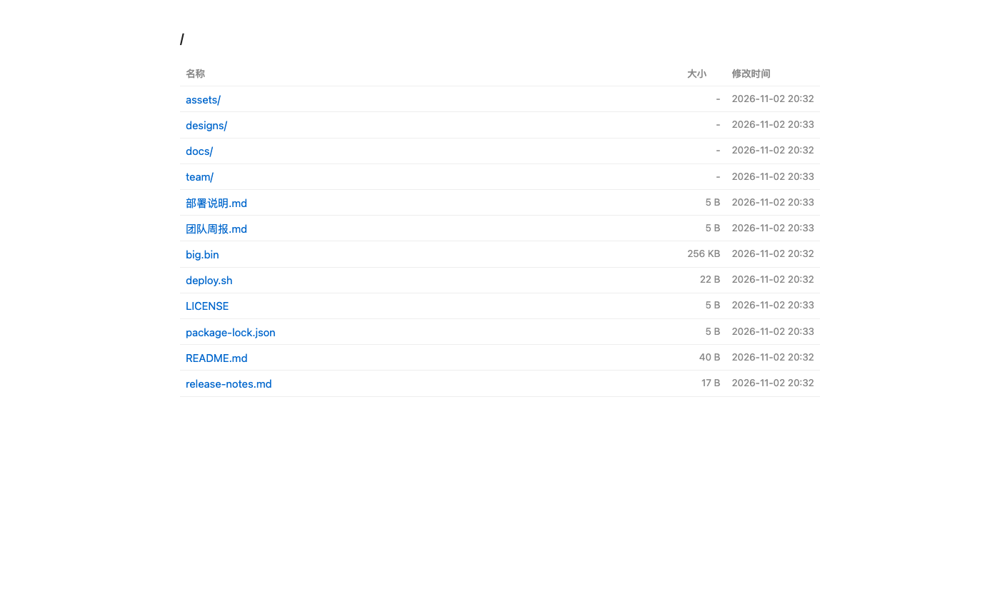
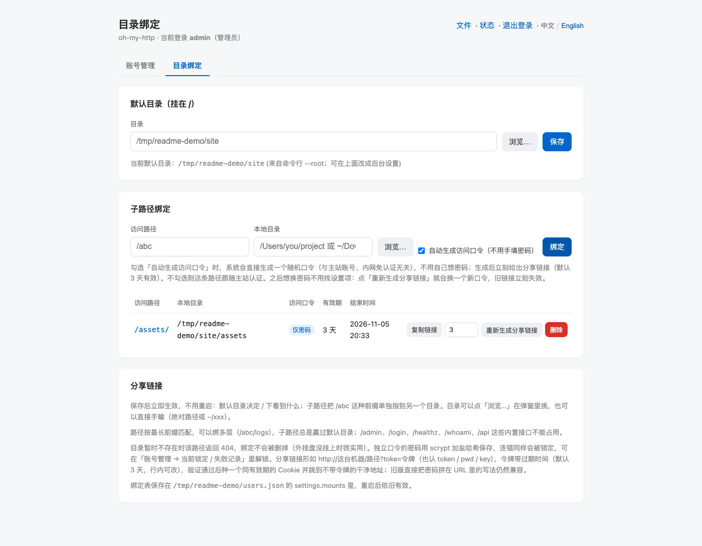
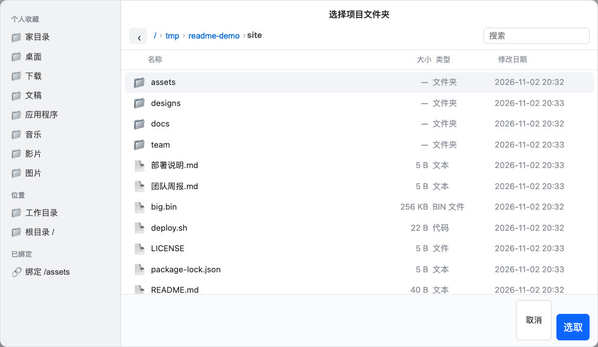
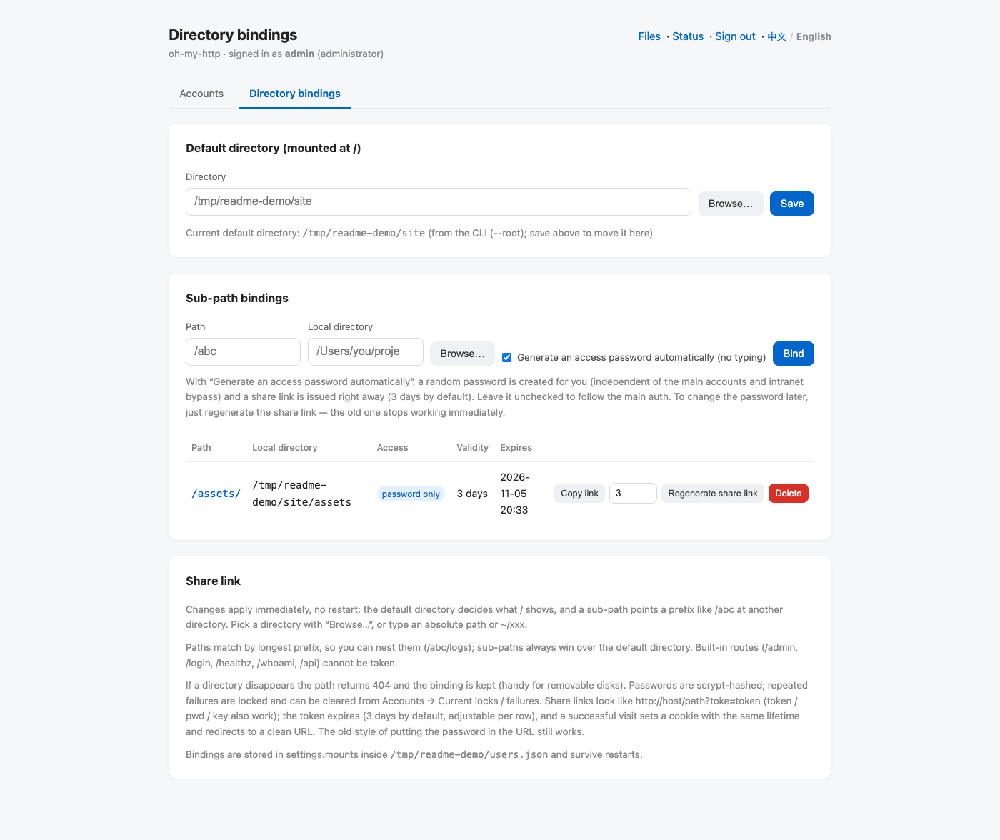

# oh-my-http

**一条命令把本机目录变成带密码的网页。** 零依赖、单进程，默认后台运行，内网免登录、外网要密码。

[English](README.en.md) · [更新日志](CHANGELOG.md) · [npm](https://www.npmjs.com/package/oh-my-http)

```bash
npx oh-my-http ~/Downloads                 # 起服务，浏览器打开 http://127.0.0.1:25250/
npx oh-my-http ~/Downloads --pass s3cret   # 加个密码（内网仍然免登录）
```

## 界面预览

目录浏览（挂在 `/`）：



目录绑定：默认目录 + 子路径、独立口令与分享链接（有效期 / 结束时间 / 复制链接）：



点「浏览…」打开仿 Finder 的目录选择弹窗（个人收藏 / 位置 / 已绑定）：



界面支持中英文，右上角一键切换（英文版见 [README.en.md](README.en.md)）：



## 特性

- **零依赖**：只用 Node 内置模块，`npm i -g` 之后一条命令即用
- **目录浏览 / 下载**：逐级浏览、显示大小与时间、有 `index.html` 优先展示
- **认证可选**：登录页 + Cookie（默认），也可以 Basic；内网来源自动免登录
- **防爆破**：按账号（可选按 IP）锁定，可在后台一键解锁
- **多目录绑定**：`/` 用默认目录，`/abc` 这类子路径单独指到别的目录，**改完立即生效、不用重启**
- **分享链接**：给某条路径自动生成口令，链接 `?toke=…` 默认 3 天有效，过期/换口令即失效
- **中英文界面**：后台设置里切换，或跟随浏览器语言
- **可当库用**：`createServer()` + `listen()`，适合嵌到自己的脚本里

要求：Node.js **>= 18.17**（ESM，MIT）。

## 安装

```bash
npm i -g oh-my-http      # 全局安装，之后直接用 oh-my-http
npx oh-my-http --help    # 或者不安装，直接用 npx
```

## 快速开始

```bash
# 1. 最简单的：当前目录挂在 /，25250 端口，不启用认证
oh-my-http

# 2. 指定目录 + 密码（第一次启动会用它创建管理员账号）
oh-my-http ~/Downloads --pass s3cret

# 3. 只要认证、不要预设密码：第一次访问 /login 时引导你创建管理员
oh-my-http ~/Downloads --require-auth

# 4. 换端口 / 只监听本机
oh-my-http ~/Downloads --port 9000 --host 127.0.0.1

# 5. 不暴露任何目录，只留内置接口
oh-my-http --no-files
```

启动后默认跑在后台，命令会立刻返回并打印端口、目录、日志位置和停止/重启命令。

## 运行管理

```bash
oh-my-http status                  # 看所有实例（PID / 端口 / 目录 / 已运行时长）
oh-my-http stop                    # 停止（多实例时加 --port）
oh-my-http restart --port 25250    # 按上次的参数重启
oh-my-http . --foreground          # 前台运行（docker / systemd / 调试）
tail -f ~/.oh-my-http/log-25250.log
```

- 默认后台；容器（PID 1）与 systemd 环境自动切前台。
- `restart` 用的是上次保存的启动参数；密码不会落盘，靠账号文件保持。
- 状态 / 日志 / 账号文件都在 `~/.oh-my-http/`（可用 `--state-dir` 改）。

## 开机自启

一条命令装成**用户级服务**（macOS LaunchAgent / Linux systemd --user）：登录后自动启动，进程挂了自动拉起。

```bash
# 把「目录 + 启动参数」原样写进服务定义，装完立即启动
oh-my-http service install ~/Downloads --port 25250 --pass s3cret

oh-my-http service status        # 装没装、在不在跑
oh-my-http service uninstall     # 停止并删除服务定义
```

- macOS → `~/Library/LaunchAgents/cn.xs25.oh-my-http.25250.plist`（`RunAtLoad` + `KeepAlive`）
- Linux → `~/.config/systemd/user/oh-my-http-25250.service`（`Restart=always`）
- 服务里跑的是**前台**进程，日志写到 `~/.oh-my-http/service-25250.log`
- 装之前先 `oh-my-http stop --port 25250`（否则手动实例占着端口，服务起不来）
- 用户级服务是「登录后」启动；要**开机不登录也跑**，得用 root 级 LaunchDaemon / systemd system 服务
  （Linux 可加 `sudo loginctl enable-linger $USER` 让 user 服务不依赖登录）

## 认证与账号

| 方式 | 说明 |
| --- | --- |
| `--pass <密码>` | 第一次启动创建管理员，之后忽略（加 `--reset-pass` 强制覆盖） |
| `--require-auth` | 启用认证但不要预设密码，首个访问 `/login` 的人创建管理员（公网来源需要启动日志里的初始化口令） |
| 都不给 | 不启用认证，谁能访问端口谁就能看文件（首页会红字警告） |
| `--auth basic` | 老式 Basic 弹窗；默认 `form` 是登录页 + Cookie |

- 账号存在 `~/.oh-my-http/users.json`（scrypt 加盐哈希、0600），角色分 **管理员 / 成员**。
- 管理员在 `/admin` 里加人、改密码、禁用、删除；至少保留一个可用管理员。
- **本机免登录**：从 `127.0.0.1` 直连（且没有 `X-Forwarded-For`）时自动以管理员身份进入，`--no-local-admin` 关闭。
- **内网免认证**：默认信任回环、私网、链路本地、ULA、CGNAT；`--trusted` 追加，`--no-default-trusted` 关闭。
- **锁定**：默认同一账号连错 3 次锁 60 分钟；失败次数与时长可在后台改，`0` 表示不锁。

## 目录绑定

命令行只绑一个目录：

```bash
oh-my-http ~/Downloads                 # 挂在 /
oh-my-http ~/Downloads --mount /files  # 加一层 /files 前缀
oh-my-http --no-files                  # 不绑目录
```

要绑多个目录，用后台的 **目录绑定** 页（`/admin/bindings`）：

| 设置 | 作用 |
| --- | --- |
| 默认目录（挂在 `/`） | `/` 下看到什么；优先于命令行的 `--root` / `--mount`，清除后回退 |
| 子路径绑定 | `/abc` → 另一个目录；按最长前缀匹配，可以嵌套（`/abc/logs`） |

- 目录可以点「浏览…」在仿 Finder 的弹窗里挑（个人收藏 / 位置 / 已绑定），也可以直接手输（绝对路径或 `~/xxx`）。
- 路径按最长前缀匹配；`/admin`、`/login`、`/healthz`、`/whoami`、`/api` 等内置接口不能被占用。
- 目录暂时不存在时那条路径返回 404，绑定不会被删掉。
- 绑定表存在账号文件的 `settings.mounts` 里，重启后依旧有效；`--users-file none` 时只在内存里。

## 分享链接

不想让别人碰主站账号？给某条子路径单独设一个口令：

1. 添加绑定时勾选「自动生成访问口令」（默认勾选），或之后点该行的「生成分享链接」。
2. 系统生成随机口令并签发链接：`http://host/gp?toke=<签名令牌>`，**默认 3 天有效**。
3. 把链接发出去即可。打开后：
   - 验签通过 → 种一个只作用于该路径、有效期同令牌的 Cookie → 跳到不带令牌的干净地址；
   - 之后点进子目录、下载文件都不用再输密码；链接本身随时可重复使用（到过期为止）。
4. 表格里能看到**有效期**与**结束时间**，没过期时可以「复制链接」直接再复制一次。
5. 想换密码：点「重新生成分享链接」。旧链接和旧 Cookie 立即失效。

补充：

- 令牌是 HMAC 签名，不含密码；口令本身只存 scrypt 哈希。
- 支持 `?toke=`（也认 `token` / `pwd` / `key`），旧写法直接把密码拼在 URL 里也仍然可用。
- 连错会按路径锁定，可在「账号管理 → 当前锁定 / 失败记录」里解锁。
- 不想再保护某条路径时，删掉绑定重新加（不勾自动口令）即可；不需要口令的路径就跟随主站认证。

## 新版本提示

有新版本时，**后台页面顶部**会直接显示横幅（当前版本 → 最新版本 + 升级命令 + 更新日志链接），
旁边还有「立即检查更新」可以手动刷新。检查结果缓存在 `~/.oh-my-http/update-check.json`：

- 启动时自动查一次（`-f` 前台跑会打印在终端；后台跑写进日志）
- 缓存超过 24 小时、或管理员打开后台时发现没查过，会**自动在后台补查一次**（10 分钟内不重复）
- 不想联网：`--no-update-check`、`OHMY_NO_UPDATE_CHECK=1`、`NO_UPDATE_NOTIFIER=1` 或 `CI=true`

## 界面语言

后台右上角可以切换 **中文 / English**，保存在账号文件里、立即生效（登录页也跟着变）。
没设置过时跟随浏览器 `Accept-Language`，都没有则默认中文。

## 内置接口

| 路径 | 说明 |
| --- | --- |
| `GET /healthz` | 公共健康检查（默认免认证） |
| `GET /whoami` | 来源 IP、认证方式与当前身份 |
| `POST /api/echo` | 回显请求（方法 / 头 / body） |
| `GET /login`、`/logout` | 登录页与退出（form 模式） |
| `GET /admin` | 账号管理（管理员） |
| `GET /admin/bindings` | 目录绑定与分享链接（管理员） |
| `GET /admin/api/dirs?path=…` | 目录浏览弹窗的数据源（管理员、只读） |

## 安全说明

- 以 `.` 开头的文件默认既不列出也不可访问（`--hidden` 放开）。
- 静态文件服务做了目录穿越防护，解析后的真实路径必须落在绑定目录内。
- 会话 Cookie 为 HttpOnly + SameSite=Lax，密钥随账号文件持久化（重启不掉登录）。
- 后台所有写操作都要 CSRF token；表单登录与 `curl -u` 共用一把锁定。
- 隧道 / 反向代理场景：`--no-default-trusted`、`--no-local-admin`、`--secure-cookie` 按需打开。

## 命令行参数

`oh-my-http --help` 是完整列表，常用的：

| 参数 | 说明 |
| --- | --- |
| `--host` / `--port` / `--addr` | 监听地址，默认 `0.0.0.0:25250` |
| `--pass` / `--require-auth` / `--auth form\|basic` | 认证方式 |
| `--root` / `--mount` / `--no-files` | 绑定目录与挂载点 |
| `--hidden` | 允许访问 `.` 开头的文件 |
| `--trusted <cidr>` / `--no-default-trusted` | 免认证网段 |
| `--account-max-attempts` / `--ip-max-attempts` / `--lockout-minutes` | 锁定策略 |
| `--users-file` / `--state-dir` | 账号文件与状态目录 |
| `--session-days` / `--remember-days` / `--secure-cookie` | 登录保持 |
| `--check-ip <ip>` | 只诊断某个 IP 会遇到什么，不启动服务 |
| `-f` / `--foreground`、`-q` / `--quiet`、`-v`、`-h` | 前台、静默、版本、帮助 |

## 作为库使用

```js
import { loadConfig, createServer, listen } from 'oh-my-http'

const cfg = loadConfig(['~/Downloads', '--pass', 's3cret'], process.env)
const server = createServer(cfg)
await listen(server, { host: '127.0.0.1', port: 8080 })
```

也可以直接用 `serveStatic`、`explainAccess`、`normalizeBindings` 这类导出的小函数，
类型见 `index.d.ts`。

## 开发与测试

```bash
git clone git@github.com:duzhenxun/oh-my-http.git && cd oh-my-http
npm test          # 单元测试（node --test）
npm run smoke     # 端到端冒烟：真的把 CLI 拉起来跑一遍
npm run demo      # 本地演示
```

CI（`.github/workflows/ci.yml`）在 Node 20 / 22 / 24 上跑测试 + 冒烟。

## 发布

打 `v*` tag 就自动发布（GitHub Actions + npm Trusted Publishing，无需 token，带 provenance）：

```bash
npm version minor -m "v%s"   # 改版本号并打 tag（会同步 lib/version.js）
git push --follow-tags
```

细节见 [RELEASING.md](RELEASING.md)。

## License

MIT
